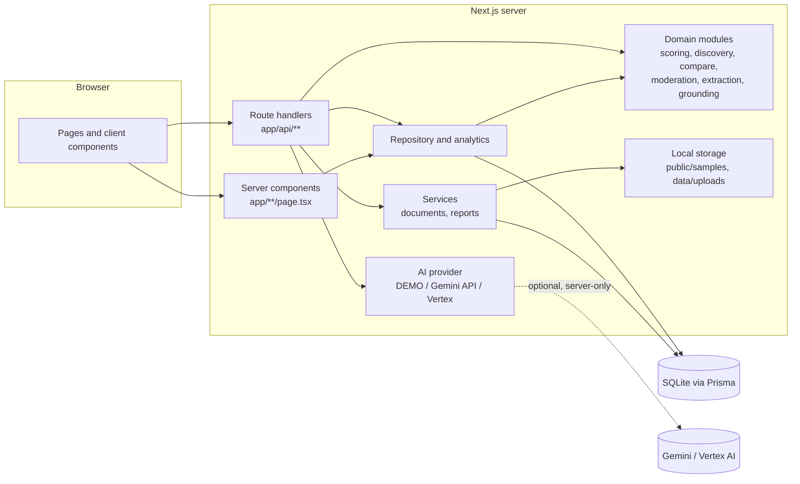
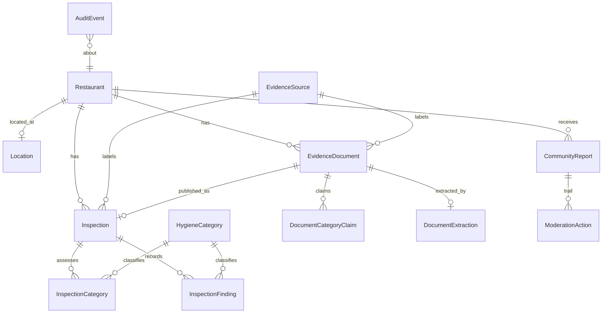

# SafeBite architecture

## 1. Shape of the system

SafeBite is a single Next.js application. Pages render on the server from the same repository functions that the route handlers use, so there is no internal HTTP hop and no separate backend to run. The database is a local SQLite file accessed through Prisma.



## 2. Layers

| Layer | Location | Responsibility |
| --- | --- | --- |
| Presentation | `src/app/**/page.tsx`, `src/components` | Server-rendered pages; client components only for interaction (filters are plain GET forms; compare selection, explainer, uploads, review, moderation and charts are client components). |
| HTTP | `src/app/api/**/route.ts` | Parse input with Zod, apply rate limits and the demo-admin gate, call services, map errors to the envelope. |
| Services | `src/lib/services` | Transactional workflows: document upload, extraction, review and publish; report intake and moderation. |
| Domain | `src/lib/scoring`, `discovery`, `compare`, `moderation`, `documents/extract.ts`, `ai/explainer.ts` | Pure functions with unit tests. No I/O. |
| Data | `src/lib/data` (repository, analytics), `prisma/` | Loads restaurants and computes view models. Only place with Prisma queries for reads. |
| Infrastructure | `src/lib/storage`, `src/lib/ai/provider.ts`, `src/lib/cloud`, `src/lib/api`, `src/lib/security` | Storage, model calls, export sinks, error envelope, rate limiter, guards. |

## 3. Data model



Key constraints and indexes (see `prisma/schema.prisma`):

- Composite primary keys on join tables (`InspectionCategory`, `DocumentCategoryClaim`).
- Foreign keys with `onDelete: Cascade` for dependent rows of restaurants, inspections and documents.
- Unique: restaurant `slug`, location per restaurant, document `storageKey`, one extraction per document, one published inspection per document.
- Indexes for the access paths the app uses: restaurant + inspection date, finding category + status, finding severity + status, report status, restaurant + report status, audit entity, and document processing status.
- Enumerations are stored as strings and validated in code against `src/lib/domain.ts`. SQLite has no native enum type.

## 4. Key flows

### 4.1 Discovery

`GET /restaurants` (page) and `GET /api/restaurants` both call `loadRestaurantProfiles()`, convert each profile to a `DiscoveryRecord`, then call `discoverRestaurants()`. That function applies the search, the filters, the sort and the pagination in memory. The dataset is small by design; see the scaling note in §8.

### 4.2 Document intelligence

```mermaid
sequenceDiagram
  participant R as Reviewer
  participant API as Route handlers
  participant S as Services
  participant FS as Local storage
  participant DB as SQLite
  R->>API: POST /api/documents (multipart)
  API->>API: rate limit, size check, zod fields
  API->>S: uploadDocument
  S->>S: magic-byte and MIME check
  S->>FS: write with random name
  S->>DB: create EvidenceDocument (status UPLOADED)
  R->>API: POST /api/documents/{id}/extract
  S->>FS: read bytes
  S->>S: PDF text, then Gemini (grounded) or rules
  S->>DB: DocumentExtraction (EXTRACTED or FAILED)
  R->>API: PUT /api/documents/{id}/review
  S->>DB: save reviewedJson (no publish)
  R->>API: PUT ... publish=true + confirmHumanReview=true
  S->>DB: transaction: Inspection + categories + findings; document PUBLISHED
```

Extraction never publishes. Publishing is blocked unless the reviewer confirms, the document is an inspection report, and the extraction succeeded.

### 4.3 AI explainer

1. Build an evidence bundle for the restaurant (IDs `S1…Sn`, `S-METHOD`). Each source points to a database record.
2. Compute the deterministic answer. Its citations always map to bundle IDs.
3. If Gemini or Vertex is configured, send the bundle as delimited, sanitised data with a JSON response schema. Accept the response only if it parses, matches the schema, cites only bundle IDs, and contains no certification claims. Otherwise return the deterministic answer and say why.
4. The response includes `mode`, `modelLabel` and `notice`, so a template is never presented as a model answer.

### 4.4 Community reports

Intake creates `PENDING` reports with a salted hash of the client address. Moderation changes status through a state machine (`src/lib/moderation/moderation.ts`) inside a transaction. The status update is conditional on the current status (optimistic concurrency), and the moderation step and audit event commit together. Public listings show only `CORROBORATED` reports.

## 5. Error handling and validation

- All input passes through a Zod schema before reaching a service.
- `handleApiError` maps `ApiError`, `ZodError`, and unknown errors to `{ error: { code, message, details? } }`. Unknown errors are logged with their type only and return a generic message.
- Status codes: 400 validation or malformed JSON, 404 not found, 409 conflict, 413 too large, 415 unsupported media type, 422 unprocessable (state or rule violation), 429 rate limited (with `Retry-After`), 403 disabled admin endpoint, 500 generic.
- Multi-step writes use `$transaction`.

## 6. Security posture

| Concern | Control |
| --- | --- |
| Upload validation | Size limit, MIME allow-list, magic-byte signature, random storage names, sanitised display names |
| Path traversal | Storage keys allow-listed by pattern and folder; resolved paths checked against base folder; upload folder must sit inside the project |
| SSRF | No endpoint fetches a URL supplied by a user |
| XSS | React escaping; no `dangerouslySetInnerHTML`; CSP and other headers in `next.config.ts` |
| Injection | Parameterised Prisma queries; zod-validated slugs; CSV formula neutralisation |
| Spam | Honeypot field, rate limits, input length limits |
| Secrets | Model keys and tokens read from server environment only; never logged or returned; `.env` git-ignored |
| Personal data | Client address hashed with a salt; no names or contact details stored |
| Admin | `requireDemoAdmin()` on moderation, uploads, review, analytics and exports. Disabled in production unless explicitly enabled |
| Prompt injection | Document text is delimited as untrusted data; model output must cite known IDs; suspicious phrases flagged to the reviewer |

**Production requirements before exposing this beyond a demo:** real authentication and role-based access (reviewer, moderator, operator), audit retention policy, a shared rate-limit store, managed database with backups, HTTPS termination with HSTS, and a documented data-retention and takedown process for community reports.

## 7. Testing strategy

| Level | What | Where |
| --- | --- | --- |
| Unit (pure domain) | Scoring, discovery, comparison, moderation, extraction, upload validation, grounding, guards, rate limiter | `src/lib/**/*.test.ts` |
| Schema and API | Request validation, error envelope, JSON parsing | `src/lib/api/*.test.ts` |
| Component | Comparison picker and tray behaviour (jsdom + Testing Library) | `src/components/*.test.tsx` |
| Data invariants | Seed covers every evidence state; files referenced exist | `src/lib/demo/seed-data.test.ts` |
| End to end | Browser journey: discovery, profile, explainer, compare, report, analytics | `e2e/demo-flow.spec.ts` |

## 8. Scaling notes

- Discovery and analytics load all profiles per request. That's fine for tens of restaurants. For thousands, precompute the transparency fields into a table on write and index the discovery columns.
- Rate limiting is per process. Use a shared store across instances (see `docs/GOOGLE_CLOUD.md`).
- SQLite is a single-writer database. For multi-instance Cloud Run, move to Cloud SQL (PostgreSQL). Prisma's provider change is the main code edit.
- Uploaded files live on local disk. Move them to Cloud Storage behind the same `saveUpload` / `readStoredFile` functions.

## 9. Directory map

```
src/app/                  pages and API routes
src/app/api/              route handlers (one per resource)
src/components/           UI and client components
src/lib/domain.ts         shared vocabulary and disclaimers
src/lib/scoring/          transparency model and tests
src/lib/discovery/        search, filter, sort, paginate
src/lib/compare/          side-by-side comparison
src/lib/moderation/       report state machine
src/lib/documents/        upload validation, extraction, PDF text
src/lib/ai/               explainer, grounding, provider, validation, Gemini extraction
src/lib/services/         transactional workflows
src/lib/data/             repository, analytics, view types, Prisma client
src/lib/cloud/            export tables, BigQuery schema, sinks
src/lib/storage/          local file storage
src/lib/security/         guards and hashing
src/lib/api/              errors, schemas, rate limiter, admin gate
src/lib/demo/             fictional seed dataset
prisma/                   schema and seed
scripts/                  sample PDF generator
e2e/                      Playwright flow
docs/                     this file, methodology, Google Cloud guide
```
