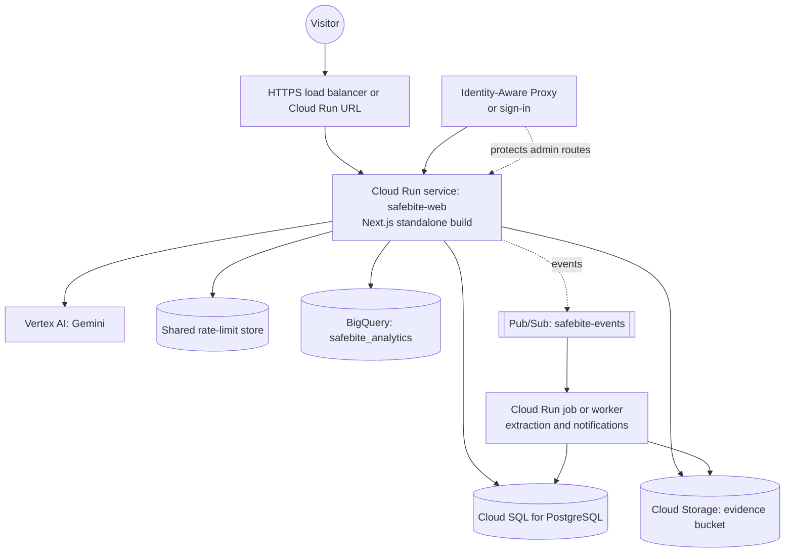

# Google Cloud integration guide

Nothing in this guide is deployed or provisioned. The application runs fully locally without any Google Cloud account. This document explains which pieces have a real code path today, which are documented only, and how to enable each one when you have approval.

## 1. What is live in code vs. documented

| Capability | Status | Where | Requires |
| --- | --- | --- | --- |
| Gemini grounded explanations (Gemini Developer API) | Code path implemented, **not exercised** against a live endpoint | `src/lib/ai/provider.ts`, `explain-service.ts` | `GEMINI_API_KEY` |
| Gemini on Vertex AI for explanations | Code path implemented, **not exercised** | same | `VERTEX_PROJECT_ID`, `VERTEX_LOCATION`, `VERTEX_ACCESS_TOKEN` |
| Gemini structured extraction for documents | Code path implemented, **not exercised**; accepted only if grounded in the document text | `src/lib/ai/gemini-extraction.ts` | same as above |
| BigQuery analytics export | Adapter implemented (`insertAll`), **not exercised** | `src/lib/cloud/export.ts` | `ANALYTICS_SINK=BIGQUERY`, `BIGQUERY_PROJECT_ID`, `BIGQUERY_DATASET`, `BIGQUERY_ACCESS_TOKEN`, tables created from the schema |
| Looker-compatible exports | Working locally: CSV and JSON Lines per table | `/api/analytics/export` | none |
| Cloud Storage for evidence files | Documented; local implementation only | `src/lib/storage/local-storage.ts` (replace `saveUpload` and `readStoredFile`) | a bucket and a service account |
| Cloud Run deployment | Documented only | §4 | a project, billing, and approval |
| Pub/Sub event processing | Documented only, not implemented | §5 | a project and topics |

"Not exercised" means the code exists and has been reviewed, but it has not been run against Google Cloud in this build. Verify it against your own project before treating it as working.

## 2. Local demo vs. cloud-enabled behaviour

| Concern | Local demo (default) | Cloud-enabled |
| --- | --- | --- |
| Explainer | Deterministic template, labelled "DEMO EXPLAINER (not Gemini)" | Gemini output, validated and cited; falls back to the template if validation fails, and says so |
| Extraction | PDF text with labelled-line rules | Gemini proposals, grounded against the text; falls back to rules |
| Analytics | JSON Lines files in `data/exports/` | BigQuery `insertAll` into `safebite_analytics` |
| Files | `public/samples`, `data/uploads` | Should move to Cloud Storage (not yet wired) |
| Database | SQLite | Should move to Cloud SQL for PostgreSQL before multi-instance deployment |
| Rate limits | In-process | Needs a shared store (for example Memorystore or Firestore) |

The app never presents a template or a local value as a cloud result. The `mode`, `modelLabel`, `provider` and `ANALYTICS_SINK` values in responses say which path ran.

## 3. Enabling Gemini (when approved)

1. Choose the path:
   - **Gemini Developer API:** create an API key in a project you control. Set `SAFEBITE_AI_MODE=GEMINI_API` and `GEMINI_API_KEY`. Keep the key server-side.
   - **Vertex AI:** enable the Vertex AI API. Use a service account or workload identity. Set `SAFEBITE_AI_MODE=VERTEX`, `VERTEX_PROJECT_ID`, `VERTEX_LOCATION` (for example `us-central1`), and a short-lived access token in `VERTEX_ACCESS_TOKEN`. For Cloud Run, prefer the service account identity over a copied token.
2. Choose a model with `GEMINI_MODEL` (default `gemini-2.5-flash`). Check current model availability and pricing for your region first.
3. Restart the server. `/api/health` reports the effective `aiMode`. If it says `DEMO`, the reason is in the explainer's `aiConfigReason` field.
4. Try a sample question. The answer must show `GEMINI` mode and cite sources. If it shows a fallback, read the notice.

Never commit keys, never prefix them with `NEXT_PUBLIC_`, and never paste them into logs or tickets.

## 4. Cloud Run architecture (documentation only)

Suggested steps when approved:

1. Replace SQLite with Cloud SQL (PostgreSQL). Change the Prisma provider and run `prisma migrate deploy`.
2. Build a standalone image: set `output: "standalone"` in `next.config.ts`, then build a container image.
3. Create a Cloud Run service with a dedicated service account. Grant it only Cloud SQL Client, Storage Object Admin on the evidence bucket, and Vertex AI User. Grant BigQuery Data Editor on the analytics dataset only if the BigQuery sink is used.
4. Put the admin routes (`/moderation`, `/documents`, `/analytics`, `/api/moderation`, `/api/documents`, `/api/analytics`) behind an identity-aware proxy or sign-in, then set `SAFEBITE_ENABLE_DEMO_ADMIN=true` only after that is in place. Without it, these endpoints return 403 in production.
5. Use Secret Manager for `GEMINI_API_KEY`, `BIGQUERY_ACCESS_TOKEN` and database credentials. Mount them as environment variables, not files in the image.

## 5. Optional Pub/Sub event processing (documentation only)

A possible design, not implemented:

- Publish `document.uploaded`, `report.submitted` and `report.moderated` events from the services after the database transaction commits.
- A worker subscribes to run OCR or extraction for large files, send notifications to moderators, and update the analytics export.
- Use a dead-letter topic and idempotent handlers keyed by event ID.

Until this exists, all processing runs inline in the request, which is acceptable for a demo.

## 6. Cloud Storage for evidence files (documentation only)

- Store objects under `evidence/{restaurantSlug}/{documentId}.{ext}`, not under user-supplied names.
- Keep the bucket private. Serve files through the app's `/api/documents/[id]/file` route, which checks status and access, or through short-lived signed URLs generated server-side.
- Enable object versioning and a retention policy suited to records that may be disputed.
- Replace `saveUpload` and `readStoredFile` in `src/lib/storage/local-storage.ts` with the same signatures, and keep the SHA-256 checksum stored in the database.

## 7. BigQuery and Looker

Export-ready tables and their schema are defined in `src/lib/cloud/export.ts` (`BIGQUERY_SCHEMA`):

- `restaurants`: one row per restaurant with its evidence score and unresolved counts, as of a timestamp.
- `inspection_findings`: one row per finding with tier, category, severity and status.
- `evidence_documents`: one row per document with kind, source tier and processing status.

To load them:

1. Create dataset `safebite_analytics` and the three tables with the schema above (in the console, or with `bq mk` and a schema file generated from `BIGQUERY_SCHEMA`).
2. Set `ANALYTICS_SINK=BIGQUERY`, `BIGQUERY_PROJECT_ID`, `BIGQUERY_DATASET` and a short-lived `BIGQUERY_ACCESS_TOKEN`.
3. Call `POST /api/analytics/export` from the operator console. The response shows the rows written per table.
4. Connect Looker Studio to the BigQuery tables and build the dashboards from the same fields the `/analytics` page uses.

Without BigQuery, download the CSV or JSON Lines exports from `/analytics`. The same schema applies.

## 8. Estimated cost considerations

These are order-of-magnitude planning notes. Check current Google Cloud pricing before committing.

| Item | What drives cost | Notes for SafeBite |
| --- | --- | --- |
| Cloud Run | vCPU and memory seconds, requests | Small for a demo. Set minimum instances to 0 to avoid idle charges. |
| Cloud SQL (PostgreSQL) | instance hours, storage, backups | Usually the largest fixed cost. Start with a small shared-core tier. |
| Cloud Storage | stored GB, operations, egress | Evidence PDFs are small (demo files are under 2 KB; real reports are typically a few MB). |
| Vertex AI / Gemini | input and output tokens per request | Explanations send a bounded evidence bundle (under about 10 KB of text). Limit requests with the built-in per-IP rate limit and set budget alerts. |
| BigQuery | storage, and queries/streaming inserts | Export tables are small. Streaming inserts are billed per GB. Schedule exports rather than writing on every page view. |
| Pub/Sub | messages | Negligible at demo volume. |
| Logging and monitoring | ingested log volume | Keep logs free of document text and personal data (the app already avoids both). |

Set a billing budget with alerts before enabling any paid service.

## 9. Local demo vs. actual cloud behaviour: a checklist

- [ ] The explainer shows "DEMO EXPLAINER" unless Gemini is configured and passes validation.
- [ ] Analytics writes local files unless `ANALYTICS_SINK=BIGQUERY` and the dataset exists.
- [ ] Sample files load from `public/samples`, not from a bucket.
- [ ] Admin routes are open only in development, or behind an authentication layer when `SAFEBITE_ENABLE_DEMO_ADMIN=true` in production.
- [ ] No credential appears in the repository, in logs, or in the browser bundle.
